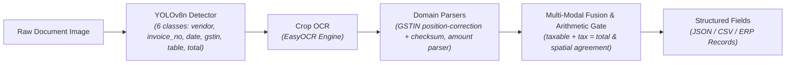
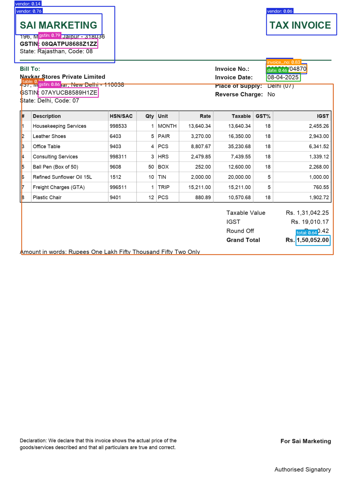
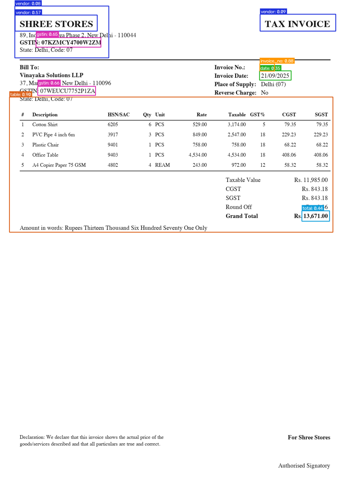

# Indian Invoice & Bill Vision Extraction Pipeline

[](LICENSE)
[](https://www.python.org/downloads/release/python-3110/)

An end-to-end document intelligence pipeline designed to extract structured entities (vendor, invoice number, billing date, GSTIN tax identifiers, table bounds, and grand total) from Indian commercial invoices and tax bills. It couples a fine-tuned YOLOv8n layout detector with crop-level EasyOCR, position-aware GSTIN checksum verification, and multi-modal arithmetic candidate fusion.

---

## 1. Pipeline Architecture



### Core Extraction Stages
1. **Document Page & Region Detection**: Fine-tuned YOLOv8n detector predicts axis-aligned bounding boxes for 6 semantic classes (`vendor`, `invoice_no`, `date`, `gstin`, `table`, `total`) at an input resolution of $1024 	imes 1024\text{ px}$.
2. **Crop-Level OCR**: High-resolution image crops for candidate regions are passed to EasyOCR with adaptive bicubic scaling to ensure legibility of compact alphanumeric characters.
3. **Domain Parsing & Checksum Verification**: Extracted text tokens are normalized and validated using domain rules, including ISO-8601 date parsing, decimal currency normalization, and official Mod-36 Luhn algorithm verification for 15-character Indian GSTINs.
4. **Multi-Modal Candidate Fusion & Arithmetic Check**: Solves visual detector misses on grand totals by pairing candidates against spatial key-value anchors and enforcing balance equations ($\text{taxable} + \text{taxes} \approx \text{grand\_total}$).
5. **Quality Gating & Human-in-the-Loop Routing**: Low-confidence detections (`conf < 0.25`) or arithmetic discrepancies are flagged with `needs_review = True` for manual triage.

---

## 2. Example Output

Below are sample detections produced by the fine-tuned YOLOv8n model (`layouts_s0_best.pt`, operating threshold $\text{conf} = 0.05$) on training-set synthetic invoices:

<p align="center">
  
</p>
<p align="center">
  <em>Synthetic invoice from Divya52/indian-gst-invoices (CC BY 4.0). Training-set example for illustration, not a test result.</em>
</p>

<p align="center">
  
</p>
<p align="center">
  <em>Synthetic invoice from Divya52/indian-gst-invoices (CC BY 4.0). Training-set example for illustration, not a test result.</em>
</p>

---

## 3. Evaluation & Results

The system was evaluated under strict pre-registered protocols. Below is a side-by-side comparison between the in-sample **Validation Set** ($n=9$ distinct invoices from 2 template families) and the held-out **Test Set** ($n=13$ distinct invoices from 11 unseen template families, evaluated in a single frozen run under Protocol v2).

For complete per-field standard breakdowns, operating point curves, review routing distributions, and template family breakdowns, see the full benchmark report: [docs/test_results_v2.md](docs/test_results_v2.md).

### 3.1 Headline Benchmark: Validation vs. Held-Out Test Set

| Metric / Target Field | Standard | Validation ($n=9$ invoices, 2 families) *(Optimistic)* | Held-Out Test ($n=13$ invoices, 11 families) *(Protocol v2)* | Empirical Delta / Generalization Reality |
| :--- | :--- | :---: | :---: | :--- |
| **Detector Overall mAP@0.50** | Ultralytics Box Eval | **0.514** | **0.291** | **-0.223 drop** on unseen real layout families |
| **`invoice_no`** *(Fused-OCR-only)* | Strict (Exact & Unflagged) | 66.7% (6/9) | **15.4% (2/13)** | Heavy typography/punctuation diversity on test |
| | Exact (Ignoring Flag) | 88.9% (8/9) | **23.1% (3/13)** | Drop driven by OCR character noise on small fonts |
| | Lenient (Normalized) | 100.0% (9/9) | **30.8% (4/13)** | Alphanumeric stripping recovers 1 additional invoice |
| **`date`** *(Fused-OCR-only)* | Strict (Exact & Unflagged) | 88.9% (8/9) | **53.8% (7/13)** | Robust format standardization across templates |
| | Exact (Ignoring Flag) | 100.0% (9/9) | **53.8% (7/13)** | Calendar equivalence matches exact string |
| | Lenient (ISO Calendar) | 100.0% (9/9) | **53.8% (7/13)** | Strongest field across unseen layouts |
| **`total`** *(Fused-OCR-only)* | Strict (Exact & Unflagged) | 0.0% (0/9)* | **15.4% (2/13)** | *66.7% (6/9) on val only with PDF text layer |
| | Exact (Ignoring Flag) | 0.0% (0/9)* | **15.4% (2/13)** | OCR missed itemized tax lines on 11/13 bills |
| | Lenient ($\pm 0.01$) | 0.0% (0/9)* | **15.4% (2/13)** | Arithmetic balance subset search fails when OCR misses taxes |
| **`gstin` (Token Set Recall)** | Valid Checksum Tokens | 83.3% (10/12) | **18.8% (3/16)** | OCR misreads on 8pt text fail Mod-36 Luhn check |
| **`gstin` (Document Match)** | $\ge 1$ Matching GSTIN | 100.0% (9/9) | **30.0% (3/10)** | Document-level retrieval of supplier or buyer GSTIN |
| **Review Gate (Routing Share)** | Routed to Manual Review | 100.0% (9/9) | **76.9% (10/13)** | 3 test documents safely auto-accepted straight-through |
| **Auto-Accept Accuracy** | Unflagged Fields | 60.9% (14/23) | **45.8% (11/24)** | 0% false accepts on flagged fields (0/15 errors leaked) |

> [!IMPORTANT]
> **Key Empirical Caveats & Engineering Observations**:
> 1. **Distribution Shift on Unseen Layouts**: Detector mAP@0.50 dropped from **0.514** to **0.291** when moving from the 2 validation template families to the 11 unseen test template families. Small synthetic fine-tuning datasets provide basic spatial priors but do not generalize across arbitrary real layout topologies.
> 2. **OCR & Parser Ceilings (Setting b)**: In Setting (b), human ground-truth bounding boxes were provided directly to the crop OCR and domain parsers. Accuracy for `invoice_no` achieved **strict 46.2% (6/13)** and **lenient 53.8% (7/13)**; `total` achieved **strict 30.8% (4/13)**, **ignore-flag 53.8% (7/13)**, and **lenient 53.8% (7/13)**; `date` achieved **strict 30.8% (4/13)** and **lenient 38.5% (5/13)**; and `gstin` set recall achieved **25.0% (4/16)**. This proves that **~46% to 75% of end-to-end extraction errors stem from OCR character misreads and rigid regex parsers**, rather than detector localization failures.
> 3. **Total Amount Disaggregation**: The validation total score of 66.7% (6/9) relied strictly on the digital PDF text layer for own bills; under pure EasyOCR, validation total extraction scored **0.0% (0/9)**, comparable to test at **15.4% (2/13)**. Arithmetic equations require complete itemized line items, which general-purpose OCR frequently misses.
> 4. **Rules Baseline Comparison**: Comparing the full-page spatial rules baseline (Setting c) against the Fused-OCR-only headline benchmark: `invoice_no` strict **2/13 vs 2/13**, lenient **3/13 vs 4/13**; `date` **6/13 vs 7/13**; `total` **2/13 vs 2/13**; and `gstin` **2/16 vs 3/16**. **All differences are within one invoice at $n=13$, so there is no evidence fusion beats the rules baseline on the test set.**
> 5. **Quality Gate Triage**: Flagging fields with low combined confidence (`conf < 0.25` or checksum failure) routed 76.9% of invoices and leaked **zero errors** among flagged fields (0/15 strictly correct), but unflagged precision (45.8%) confirms confidence calibration is required before unattended production deployment.
> 6. **Primary Weights Benchmark**: All test benchmarks were established strictly with the pre-declared PRIMARY weights (`layouts_s0_best.pt`).

### 3.2 Detector Training Ablations (Experiments 1, 2, and 3)

#### Experiment 2: Multi-Layout Synthetic Invoices (`yolo_v2` Layouts Baseline)
Evaluated across 5 random seeds comparing real baseline training ($n=33$ images) vs. real + multi-layout synthetic invoices ($n=57$ images, `yolo_v2`):

| Random Seed | Real Baseline ($n=33$) | Layouts Dataset `yolo_v2` ($n=57$) | Seed Gain $\Delta$ | Favors Layouts? | Caveat |
| :---: | :---: | :---: | :---: | :---: | :--- |
| **Seed 0** | 0.337 | **0.514** | +0.177 | Yes | Peak seed chosen for primary evaluation |
| **Seed 1** | 0.391 | **0.460** | +0.069 | Yes | Consistent moderate improvement |
| **Seed 2** | 0.353 | **0.408** | +0.055 | Yes | Consistent moderate improvement |
| **Seed 3** | 0.371 | **0.416** | +0.045 | Yes | Below +0.05 threshold |
| **Seed 4** | 0.429 | **0.430** | +0.001 | Yes | Effective statistical tie |
| **Mean** | **0.376** | **0.446** | **+0.069** | **5 / 5 Pairs** | **Mean gain driven disproportionately by Seed 0** |

#### Experiment 3: Expanded Multi-Layout Synthetic Invoices (`yolo_v3`) — Completed (Negative Result)
Pre-registered hypothesis: Expanding synthetic multi-layout training images from 24 to 84 (total 117 images: 33 real + 84 synthetic across the same 4 layouts) improves validation mAP50 by $\ge +0.03$ with $\ge 4/5$ pairs favoring v3.
- **Results across 5 Seeds**: Seed 0: $0.514 \to 0.455$ (-0.059), Seed 1: $0.460 \to 0.441$ (-0.018), Seed 2: $0.408 \to 0.371$ (-0.037), Seed 3: $0.416 \to 0.397$ (-0.019), Seed 4: $0.430 \to 0.536$ (+0.106).
- **Mean Validation mAP50**: **0.446 vs 0.440** (mean gain $\Delta = -0.005$); same-seed pairs favoring v3: **1 / 5 pairs**.
- **Conclusion**: The pre-registered decision rule was **NOT met**. Adding 60 additional synthetic invoices of the same 4 layout topologies provided zero empirical benefit and slightly increased overfitting. The model baseline remained pinned to `yolo_v2` (`layouts_s0_best.pt`). See [docs/experiments.md](docs/experiments.md#experiment-3-expanded-multi-layout-synthetic-invoices-datayolo_v3) for full training logs.

---

## 4. Honest Limitations & Next Steps

### 4.1 System Limitations
- **Small Sample Regimes**: Validation consists of 12 images ($n=9$ invoices across 2 template families), and test consists of 14 images ($n=13$ invoices across 11 template families). In small-sample regimes, individual invoice edge cases have high leverage on aggregate percentage metrics.
- **In-Sample Fusion Optimism**: Multi-modal fusion heuristics and arithmetic balance equations were engineered after analyzing validation failure modes, explaining why validation accuracy (100% on date, 88.9% on invoice number) exceeds test generalization (53.8% on date, 30.8% on invoice number).
- **Seed-0 Selection**: Primary weights (`layouts_s0_best.pt`) represent the best single seed on validation (0.514 vs 5-seed mean of 0.446); excluding Seed 0 reduces the average synthetic training gain from $+0.069$ to $+0.042$.
- **No Phone-Photo Evidence**: Evaluated solely on digital PDF renders and clean scans; zero real handheld smartphone photos with camera perspective distortion, creases, or shadows have been evaluated.

### 4.2 What I Would Do Next
If continuing development of this system, the engineering priorities would be:
1. **Diverse Real-World Layout Datasets**: Expand training and evaluation beyond 11 template families by collecting and annotating authentic, diverse Indian commercial invoices across multiple states, industry sectors, and bilingual formats (Hindi/English).
2. **Pretrained Multi-Modal Document Architectures**: Migrate from visual-only YOLOv8n to multi-modal document intelligence foundation models (e.g., LayoutLMv3, Donut, or DocQuery) that natively co-embed 2D spatial coordinates, visual layout features, and OCR text embeddings.
3. **Domain-Adapted OCR Engine**: Replace general-purpose EasyOCR with a fine-tuned text recognition model (e.g., PaddleOCR, TrOCR, or a specialized Indian GST receipt recognition model) to overcome the ~50% extraction ceiling observed even under perfect human bounding boxes.
4. **Calibrated Confidence Scoring**: Implement post-hoc confidence calibration (such as Platt scaling, temperature scaling, or conformal prediction) to establish statistically reliable confidence thresholds for straight-through automated ERP ingestion ($\ge 95\%$ target accuracy on unflagged fields).

---

## 5. Quick Start

### 5.1 Environment Setup
```bash
# Clone and enter the repository
git clone <repo-url>
cd invoice-vision-public

# Create and activate Python 3.11 virtual environment
python -m venv .venv
.venv\Scripts\activate   # Windows
# source .venv/bin/activate # Linux / macOS

# Install pinned dependencies
pip install -r requirements.txt
```

### 5.2 Run Test Suite
```bash
# Execute unit and integration tests (102 passed, 9 skipped without local assets)
python -m pytest -q
```

### 5.3 Protocol Verification
```bash
# Verify test guardrails (dry-run mode; does not evaluate or touch test split)
python scripts/run_final_test.py --verify-only
```

---

## 6. Project Structure

```text
invoice-vision-public/
├── configs/
│   ├── default.yaml              # Pipeline hyperparameters and quality gate thresholds
│   └── yolo_v1.yaml              # YOLOv8n detector training and augmentation configuration
├── docs/
│   ├── images/                   # Sample detection previews for documentation
│   ├── annotation_guideline.md   # Bounding box annotation rules and class semantics
│   ├── experiments.md            # Empirical training logs and 5-seed validation tables
│   ├── fusion_experiment.md      # Candidate fusion and arithmetic validation ablations
│   ├── limitations.md            # Detailed failure modes and technical constraints
│   └── test_protocol.md          # Frozen test protocol v2 guardrails and verification
├── notebooks/
│   └── colab_train.ipynb         # GPU training notebook for YOLOv8n experiments
├── scripts/
│   ├── build_yolo_dataset.py     # Assembles YOLO directory from split manifests
│   ├── compare_prelabels_vs_reviewed.py # Measures annotation effort across batches
│   ├── eval_fusion.py            # Evaluates multi-modal candidate fusion on validation
│   ├── eval_pipeline.py          # End-to-end extraction evaluation across settings (a, b, c)
│   ├── fetch_gst_synth.py        # Fetches synthetic invoice assets from Hugging Face
│   ├── run_final_test.py         # Guarded single-run test split evaluation harness
│   └── suggest_own_labels.py     # Heuristic pre-label generator for invoice documents
├── src/
│   └── invoice_vision/
│       ├── detect/               # YOLO detector inference wrapper
│       ├── ocr/                  # EasyOCR engine integration and crop upscaling
│       ├── parse/                # Regex parsers and Mod-36 Luhn GSTIN checksum validator
│       ├── pipeline/             # Candidate fusion, arithmetic gate, and end-to-end extractor
│       ├── preprocess/           # Document quad detector, perspective warp, and quality gate
│       └── validate/             # Label validation and bounding box geometry checks
├── tests/                        # Comprehensive pytest test suite (111 tests)
├── LICENSE                       # MIT License
├── pytest.ini                    # Pytest configuration
├── requirements.txt              # Pinned dependencies
└── README.md                     # Project documentation
```

---

## 7. Data & Licenses

- **Synthetic Multi-Layout Invoices (Training & Samples Only)**: Sourced from [`Divya52/indian-gst-invoices`](https://huggingface.co/datasets/Divya52/indian-gst-invoices) under Creative Commons Attribution 4.0 International ([CC BY 4.0](https://creativecommons.org/licenses/by/4.0/)). Used only for training augmentation and for the two sample illustration images in this README. Synthetic assets can be downloaded via `scripts/fetch_gst_synth.py`.
- **Public Test Images (Unlicensed External Dataset)**: Sourced from a third-party Hugging Face invoice dataset with no open license or dataset card (`adityaeucloid/test_dataset`), used locally for held-out evaluation and **not redistributed** in this public repository.
- **Private Personal Bills**: Personal bills used locally during development are excluded from version control and are **not redistributed** in this public repository.

---

## 8. License

This project is licensed under the MIT License — see the [LICENSE](LICENSE) file for details.
